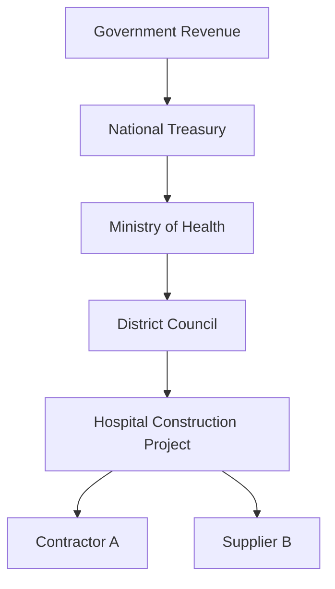
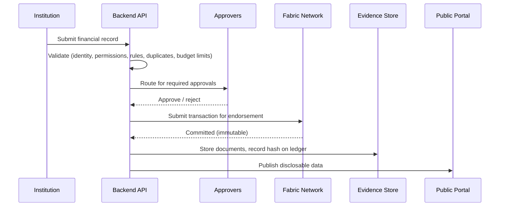
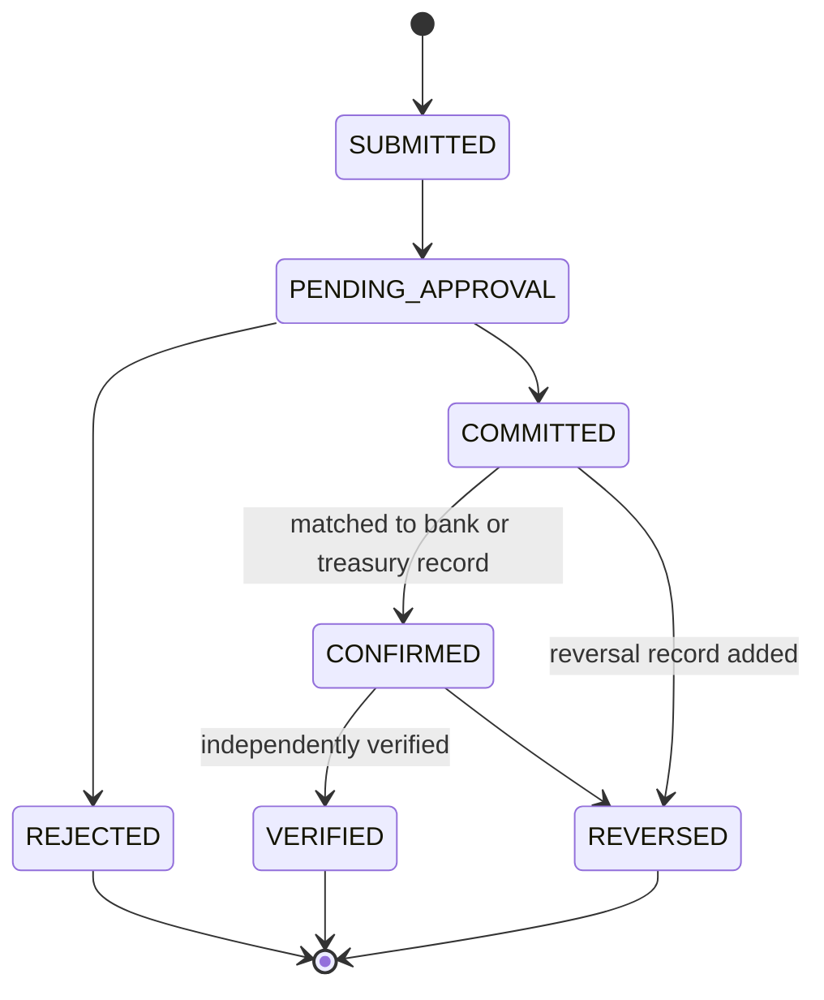
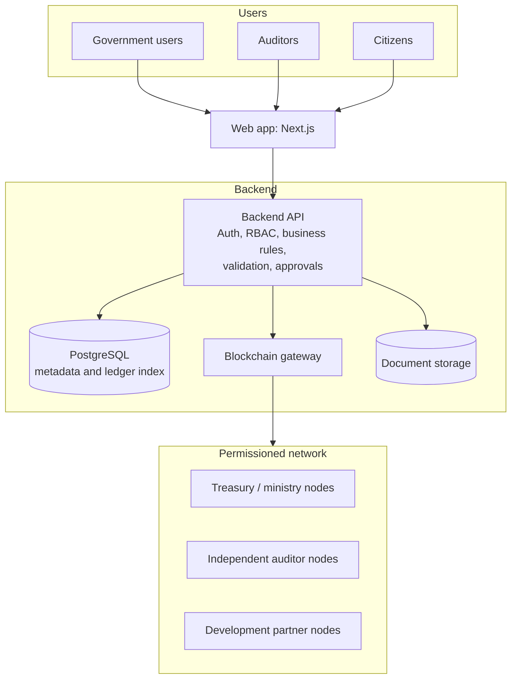

# FundTrace Group 3

### Follow the money. Verify the impact.

FundTrace is a blockchain-backed platform that gives governments, auditors, and citizens a **shared, tamper-evident record of public money**: where it comes from, where it goes, and what it delivers.

Institutions record budgets, transfers, and payments on a permissioned ledger. Every record is linked to its budget, its project, its approvals, and its supporting evidence. A public portal then lets anyone follow a kwacha from approval to payment to project.

> **Status:** concept and design stage. Features below describe the intended system, not shipped functionality. See [Project Status](#project-status).

---

## Table of Contents

- [Why FundTrace](#why-fundtrace)
- [What FundTrace Is (and Is Not)](#what-fundtrace-is-and-is-not)
- [Core Features](#core-features)
- [How It Works](#how-it-works)
- [Financial Record Model](#financial-record-model)
- [System Architecture](#system-architecture)
- [Blockchain Design](#blockchain-design)
- [User Roles](#user-roles)
- [Security and Privacy](#security-and-privacy)
- [Limits of Blockchain](#limits-of-blockchain)
- [Technology Stack](#technology-stack)
- [Roadmap](#roadmap)
- [Expected Impact and Success Metrics](#expected-impact-and-success-metrics)
- [Risks and Open Questions](#risks-and-open-questions)
- [Project Status](#project-status)
- [Contributing](#contributing)
- [License](#license)

---

## Why FundTrace

Governments collect money through taxes, grants, loans, and donations, then move it through treasuries, ministries, local councils, and contractors. Each step usually lives in a different system.

That fragmentation causes recurring problems:

- **Poor public visibility.** Citizens cannot easily see what was budgeted, released, or spent.
- **Broken traceability.** Following funds from source to final recipient means stitching together disconnected records.
- **Slow reconciliation.** Auditors spend time matching records rather than investigating discrepancies.
- **Budget drift.** Spending that exceeds approved allocations is found late, if at all.
- **Unverified claims.** A recorded payment is hard to tie to a real bank confirmation or a real project outcome.

Conventional databases can keep good financial records, but their integrity depends on whoever administers them. FundTrace uses a ledger **shared and endorsed by several independent organizations**, so no single party can quietly rewrite history.

---

## What FundTrace Is (and Is Not)

| FundTrace **is** | FundTrace **is not** |
|---|---|
| A shared, append-only record of financial events | A replacement for the government's accounting or payment systems |
| A traceability layer linking budgets, payments, and projects | A system that moves real money |
| An audit aid that flags records for review | A fraud detector. An alert is a lead, not a finding |
| A public portal for disclosable data | A guarantee that every recorded payment actually happened |
| Tamper-evident | Tamper-proof, or a source of truth about the physical world |

The design deliberately separates three claims that are often blurred:

1. **Recorded:** an institution submitted this entry.
2. **Confirmed:** an authoritative source (treasury system, bank) corroborates it.
3. **Verified:** an auditor or independent party checked the outcome.

---

## Core Features

### 1. Financial record management
Structured records of revenue receipts, budgets and revisions, allocations, commitments, transfers, payments, expenditure, reversals, and corrections. Each has a unique ID, timestamp, type, and references to the entities involved.

### 2. Budget allocation tracking
Follow a budget from approval to allocation to commitment to payment. The system keeps **authorization** (permission to spend) separate from **money actually moved**, and shows remaining available budget where verified data exists.

### 3. Fund flow tracing



Each arrow is a **recorded financial event** with its own status, approvals, and evidence, not an assumption that money physically moved.

### 4. Public transparency portal
A searchable dashboard of information cleared for public disclosure:

- Approved budgets and recorded revenue
- Allocations by ministry or department
- Expenditure by financial period
- Inter-institution transfers
- Funding per development project
- Transactions awaiting confirmation or verification

Every figure shows its reporting period, data source, and verification status. Filters cover institution, project, transaction type, and financial year.

### 5. Project financial monitoring
Each project page links its budget, funding sources, transactions, contract and procurement references, documents, milestones, and audit findings. Financial progress is shown **separately from physical progress**, because money spent is not the same as work completed.

### 6. Audit and verification tools
For authorized auditors:

- Transaction history and ledger verification
- Budget-to-expenditure reconciliation
- Rule-based flags: duplicate references, spending above allocation, missing evidence, unusual approval patterns
- Audit findings with tracked resolution

### 7. Role-based access and multi-party approval
Institutions submit only their own records and cannot approve their own submissions or edit another institution's. Sensitive operations require multiple approvals.

### 8. Transaction verification
Records can be matched against treasury and financial management systems, bank payment confirmations, official payment references, approved invoices and vouchers, and independent audit records. Available integrations depend on each participating institution.

### 9. Immutable corrections
Committed records are never silently edited or deleted. Errors are fixed with a **correction** or **reversal** that references the original and states the reason, preserving the audit history.

---

## How It Works



1. **Register.** An authorized institution submits a record: activity, amount, parties, type, and the linked budget or project.
2. **Validate.** The application checks identity, permissions, required fields, duplicate references, budget limits, and approval requirements. *Passing validation does not prove the underlying payment occurred.*
3. **Approve.** Transactions that need extra authorization go to the right officials, and the approval history is kept.
4. **Commit.** Once conditions are met, the transaction goes to the permissioned network, which applies endorsement and consensus rules. Committed transactions join the ledger.
5. **Attach evidence.** Payment confirmations, invoices, and authorizations are linked. Sensitive files stay off-chain, with a cryptographic hash on the ledger. *A matching hash shows a file has not changed since hashing; it does not show the file is authentic or true.*
6. **Publish.** Disclosable data appears on the portal. Restricted data stays restricted.
7. **Track and audit.** Users follow related transactions and verification status. Auditors reconcile against authoritative sources and record findings.

---

## Financial Record Model

FundTrace never treats a recorded amount as money already spent. Each event type has distinct meaning:

| Event type | Meaning |
|---|---|
| Revenue Receipt | Money received by a government entity |
| Budget Approval | Authority to spend up to an amount for an approved purpose |
| Budget Revision | An approved change to a budget |
| Fund Allocation | Distribution of budget authority or funding to an institution or purpose |
| Commitment | A financial obligation, such as an approved contract or purchase order |
| Transfer | Recorded movement of funds between accounts or institutions |
| Payment | A payment recorded by the relevant financial system |
| Expenditure Verification | Confirmation that expenditure meets defined verification requirements |
| Reversal | Reverses the accounting effect of an earlier transaction |
| Correction | An additional record fixing an identified error |

Exact definitions and accounting treatment should follow the rules of the participating institutions.

### Transaction lifecycle



### Integrity rules enforced by the ledger

Chaincode (smart contract) logic should reject or flag entries that break these invariants:

- Cumulative **payments** ≤ **commitments** ≤ **allocations** ≤ **approved budget**, per budget line
- No duplicate `referenceNumber` per institution
- A submitter cannot approve their own transaction
- A correction or reversal must reference an existing committed transaction
- Amounts use fixed-precision decimals and an explicit currency

### Example transaction

```json
{
  "transactionId": "FT-TXN-2026-0001",
  "transactionType": "PAYMENT",
  "projectId": "FT-PRJ-2026-001",
  "reportingInstitution": "MINISTRY-001",
  "sourceInstitution": "TREASURY-001",
  "destinationInstitution": "SUPPLIER-042",
  "amount": "25000000.00",
  "currency": "MWK",
  "referenceNumber": "PAY-REF-001",
  "recordedAt": "2026-10-17T10:00:00Z",
  "verificationStatus": "PENDING",
  "evidenceReference": "DOC-REF-001",
  "correctionOf": null
}
```

*Illustrative only, not a finalized schema.* This is a recorded payment submission with pending verification. It does not establish that a real payment occurred.

---

## System Architecture



*Conceptual architecture. Final choices depend on requirements gathered during discovery.*

| Component | Role |
|---|---|
| **Web app** | Admin interface, dashboards, project pages, public portal |
| **Backend API** | Authentication, authorization, business rules, validation, approval workflow, ledger communication |
| **PostgreSQL** | Searchable metadata, accounts, org and project data, and an indexed copy of ledger events for fast queries. **Not** the source of integrity; the ledger must stay independently verifiable |
| **Blockchain gateway** | Submits transactions, reads ledger state, handles responses and events |
| **Permissioned network** | Operated by participating organizations; holds the shared ledger |
| **Document storage** | Protected off-chain storage for evidence; hashes anchored on-chain |

---

## Blockchain Design

FundTrace uses a **permissioned blockchain**: participation is limited to identified organizations under agreed governance rules. This suits cooperation between government bodies and independent institutions that must share a trusted history while respecting legal and confidentiality requirements.

### Network participants

- Treasury or finance authority
- Ministries and departments
- Authorized public financial institutions
- Independent audit institutions (supreme audit institution, civil society auditors where appropriate)
- Approved development partners

Citizens read permitted data through the portal and do not need to run nodes.

### Candidate framework: Hyperledger Fabric

[Hyperledger Fabric](https://hyperledger-fabric.readthedocs.io/) offers organizational identity and membership, endorsement policies, channels, and private data collections.

Design points to settle early:

- **Endorsement policy.** For example, a payment must be endorsed by the submitting ministry **and** treasury **and** at least one independent auditor node. This is where "no single party controls the record" becomes real.
- **Ordering service.** Raft is crash-fault tolerant but not Byzantine-fault tolerant. Evaluate SmartBFT (Fabric 3.x) if tolerance of malicious orderers matters.
- **Channels and private data collections** for confidential procurement details.
- **Node distribution.** If one organization runs most nodes, decentralization is cosmetic.

The team should confirm Fabric's fit after assessing deployment complexity, governance, expected transaction volume, privacy requirements, and available skills. Alternatives such as Hyperledger Besu or a permissioned EVM chain are worth comparing.

### On-chain vs. off-chain

| On-chain | Off-chain |
|---|---|
| Transaction IDs, types, amounts, currencies | Large documents and scans |
| Institution identifiers | Personal or sensitive data |
| Budget and project references | Confidential procurement details |
| Timestamps and sequence | Anything not needed by every node |
| Approval and endorsement references | |
| Evidence references and document hashes | |
| Links to correction and reversal records | |

Because the ledger is append-only, keep personal data off it. Final schema decisions must account for privacy, retention rules, and storage cost.

---

## User Roles

| Role | Responsibilities |
|---|---|
| Government Financial Administrator | Manages authorized financial records and institutional information |
| Budget Officer | Registers budgets, allocations, and approved revisions |
| Transaction Approver | Reviews and authorizes transactions within assigned limits |
| Auditor | Examines records, verifies evidence, documents findings |
| Development Partner | Monitors funding commitments, disbursements, and project records |
| Contractor or Supplier | Sees permitted contract, invoice, and payment information |
| Public User | Views public financial and project information |
| System Administrator | Manages configuration, accounts, and technical operations |

Permissions follow least privilege. Submission, approval, and audit duties are separated wherever practical.

---

## Security and Privacy

**Identity and authentication**
- Authenticate users before any restricted action.
- Tie submissions and approvals to verified institutional identities.
- Protect privileged accounts with strong authentication (for example MFA and hardware keys).

**Authorization**
- Require approval for sensitive operations, with transaction-specific policies.
- Record the full approval and endorsement history.

**Data integrity**
- Make retrospective tampering detectable through the ledger.
- Use hashes for document integrity checks.
- Preserve corrections and reversals as new records.

**Privacy and confidentiality**
- Classify data by disclosure level before publication.
- Keep personal data off the ledger.
- Encrypt off-chain documents and apply retention and access policies.

**Operations**
- Log administrative actions and failed authorization attempts.
- Maintain key management, backup, and incident response procedures.
- Support independent verification and reconciliation.

---

## Limits of Blockchain

Blockchain protects the integrity of data **after it is recorded**. It cannot, on its own:

- **Make false data true.** If a payment is recorded that never happened, the ledger faithfully preserves the falsehood. This is why FundTrace separates *recorded*, *confirmed*, and *verified*, and why evidence matching and independent audit matter.
- **Prove physical delivery.** A recorded payment does not show that a road was built or a clinic stocked.
- **Replace governance.** A permissioned network is only as trustworthy as the organizations running it and how control is distributed.
- **Ensure transparency by itself.** Transparency depends on what institutions choose, or are required, to publish.
- **Prevent collusion.** If enough endorsing parties collude, they can record misleading data. Independent auditor nodes and public disclosure reduce this risk but do not eliminate it.
- **Remove the need for law and enforcement.** Findings still need institutions willing to act on them.

FundTrace is a tool that makes oversight easier and manipulation more visible. It is not a substitute for oversight.

---

## Technology Stack

*Proposed, subject to change.*

| Layer | Candidate |
|---|---|
| Frontend | Next.js, TypeScript |
| Backend | Node.js / TypeScript (NestJS or Express) |
| Database | PostgreSQL |
| Ledger | Hyperledger Fabric (chaincode in Go or TypeScript) |
| Document storage | S3-compatible object storage, with optional IPFS-style content addressing |
| Identity | Fabric CA, plus OIDC/SSO for application users |
| Deployment | Docker, Kubernetes |
| Observability | Prometheus, Grafana, structured logging |

---

## Roadmap

### Phase 0: Discovery and governance
- [ ] Map stakeholders and existing financial systems
- [ ] Define the data classification and disclosure policy
- [ ] Agree network governance: who runs nodes, endorsement policies, dispute handling
- [ ] Finalize the financial event model with finance experts

### Phase 1: Prototype
- [ ] Fabric test network with at least three organizations (treasury, ministry, auditor)
- [ ] Chaincode for budgets, allocations, commitments, payments, and corrections
- [ ] Backend API with RBAC and approval workflow
- [ ] PostgreSQL indexer for ledger events
- [ ] Basic dashboard and transaction trace view

### Phase 2: Pilot
- [ ] One ministry, one district council, one funded project
- [ ] Import from an existing financial system, or a controlled manual process
- [ ] Evidence hashing and document storage
- [ ] Auditor tools and reconciliation reports
- [ ] Public portal with project pages

### Phase 3: Scale
- [ ] Onboard more institutions
- [ ] Bank and treasury integrations
- [ ] Open data API
- [ ] Performance, security audit, and disaster recovery testing

---

## Expected Impact and Success Metrics

**Intended outcomes**
- Public money becomes easier to follow from approval to project
- Faster audit reconciliation
- Earlier detection of spending beyond allocation
- Higher citizen and donor confidence in disclosed data

**How the pilot will be measured**
- Share of pilot transactions with linked evidence
- Time to reconcile a budget line, before and after
- Discrepancies detected, and how many are resolved
- Portal usage and citizen feedback
- Share of records progressing from *recorded* to *confirmed*

---

## Risks and Open Questions

| Risk | Mitigation |
|---|---|
| Institutions resist transparency | Start with a willing ministry and donor-funded projects; secure executive sponsorship |
| Poor data quality at the source | Validation rules, evidence requirements, clear "recorded vs verified" labels |
| Centralized control of nodes | Require independent auditor nodes and a published governance charter |
| Legal limits on disclosure | Disclosure classification and legal review before publication |
| Integration with legacy systems | Phase integrations; begin with controlled imports |
| Key compromise | HSM-backed keys, rotation policy, incident response plan |
| Sustainability and funding | Define hosting, maintenance, and ownership early |
| Capacity | Training for finance staff, auditors, and node operators |

**Open questions:** Who owns and governs the network? Which law mandates publication of what? How will bank and treasury confirmations be obtained? Who pays for nodes long term?

---

## Project Status

**Stage:** concept and design.

| Area | Status |
|---|---|
| Problem definition and concept | Done |
| Architecture and data model | Draft |
| Chaincode | Not started |
| Backend and frontend | Not started |
| Pilot partner | Not yet identified |

---

## Contributing

Contributions are welcome, especially from people with backgrounds in public finance, auditing, Hyperledger Fabric, secure backend development, and civic technology.

1. Open an issue to discuss significant changes.
2. Fork the repository and create a branch.
3. Submit a pull request with a clear description.

Please do not include real government data, credentials, or personal information in issues or commits.

---

## License

To be decided. Consider Apache-2.0 (the license used by Hyperledger Fabric) or MIT.
